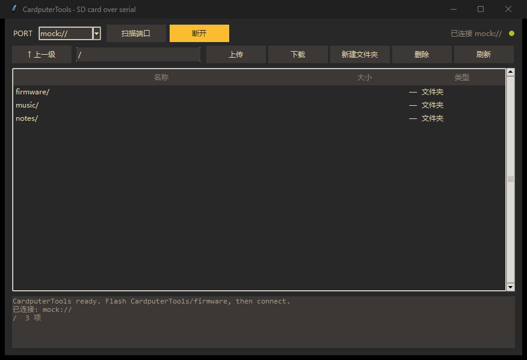

# CardputerTools · SD 卡串口管理

通过 USB 串口管理 Cardputer（一代 / ADV）microSD 卡里的文件：浏览、上传、下载、新建文件夹、删除。界面是 GruvBox Dark。



---

## 为什么有两部分

PC 上的程序没法直接读设备的 SD 卡——**卡在设备里，只有设备自己能读**。所以这套工具由两块组成：

| 部分 | 作用 |
|---|---|
| `firmware/` | 烧进 Cardputer 的桥接固件：把串口变成"文件服务器" |
| `cardputer_sd.py` | PC 端的图形界面，通过串口跟它对话 |

⚠️ 桥接固件和 **MusicTools 不能同时存在**。刷了桥接固件，音乐功能就没了；管理完文件再刷回 MusicTools 即可（两个固件用同一个分区布局，来回刷都不会丢 SD 卡数据）。

---

## 用法

### 1. 刷桥接固件

```bash
cd CardputerTools/firmware
pio run -t upload
```

烧好后屏幕会显示 `SD BRIDGE / microSD ready`。

### 2. 运行 PC 端工具

```bash
pip install pyserial

python CardputerTools/cardputer_sd.py --port COM5
```

不接设备也可以先看界面（内存里的假卡）：

```bash
python CardputerTools/cardputer_sd.py --mock
```

### 3. 操作

| 操作 | 方式 |
|---|---|
| 进入文件夹 | 双击列表项 |
| 返回上级 | `↑ 上一级` |
| 上传 | 选中目标目录 → `上传` → 选本地文件 |
| 下载 | 选中文件 → `下载` → 选保存位置 |
| 新建文件夹 | `新建文件夹` |
| 删除 | 选中 → `删除`（会二次确认） |
| 刷新 | `刷新` |

---

## 串口协议

纯文本行命令，方便抓包和手写脚本（115200，实际走 USB CDC 不看波特率）：

| 命令 | 回复 |
|---|---|
| `PING` | `PONG 1 cardputer-sd` |
| `LS <path>` | `OK <n>` + n 行 `名字<TAB>大小<TAB>d/f` |
| `GET <path>` | `OK <size>` + size 字节原始数据 |
| `PUT <path> <size>` | `READY` + size 字节原始数据 + `OK <written>` |
| `DEL <path>` | `OK 0` |
| `MKDIR <path>` | `OK 0` |
| `RMDIR <path>` | `OK 0` |
| `FREE` | `OK <剩余字节>` |

出错统一返回 `ERR <code> <说明>`。

---

## 已知限制

- 只支持单文件顺序传输，没有断点续传；大文件建议一次传完（`PUT` 有 8 秒空闲超时）
- `PUT` 会直接覆盖同名文件，不备份
- 没有重命名/移动命令（可以下载后重新上传）
- 桥接固件只在开机时挂载一次 SD 卡；换卡需要复位
- **未在真机上验证**：协议逻辑用内置的假设备完整跑通过，但 SPI/SD 引脚取自 M5Unified 的板级定义，实际读写没有实测

---

## 代码结构

| 文件 | 说明 |
|---|---|
| `cardputer_sd.py` | tkinter 界面 + 协议客户端 + `--mock` 假设备 |
| `firmware/src/main.cpp` | 桥接固件（SD + 串口协议 + 一个小屏状态页） |
| `firmware/platformio.ini` | 和 MusicTools 相同的板级配置 |
