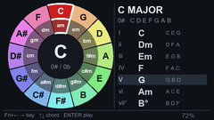
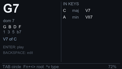

# Cardputer 五度圈 · 和弦查询固件

给 M5Stack **Cardputer / Cardputer-Adv** 的乐理查询固件，两个页面，Tab 切换：

| 页面 | 内容 |
|---|---|
| **五度圈** | 12 段圆环（外环大调 / 内环关系小调）+ 当前调的 7 个级数和弦 |
| **和弦查询** | 正查：和弦拼写、音程、属性；反查：这个和弦出现在哪些调、是什么级数 |

离线、开机即用、按 Enter 直接试听。

<p>


</p>

---

## 一、刷机

固件文件：`dist/cardputer-circle-of-fifths-8MB.bin`（**从 0x0 地址烧写**，已合并 bootloader + 分区表 + 应用）

### 方式 A：浏览器烧写（推荐，不用装任何环境）

1. 用 Chrome / Edge 打开 <https://espressif.github.io/esptool-js/>
2. 点 **Connect**，选择 Cardputer 的串口（COMx）
3. 选择文件 `cardputer-circle-of-fifths-8MB.bin`
4. **Flash Address 填 `0x0`**
5. 点 **Program**，等待进度条到 100%

### 方式 B：esptool 命令行

```bash
pip install esptool
esptool.py --chip esp32s3 -p COM3 -b 460800 write_flash 0x0 cardputer-circle-of-fifths-8MB.bin
```

### 方式 C：M5Burner

M5Burner → 选择设备 → **Custom** / 本地固件 → 选 bin → 烧录地址 `0x0`。

进不去下载模式时：按住侧面 **G0** 再插 USB-C，或按复位后立即按住 G0；烧写完按复位。

---

## 二、操作

### 五度圈页

| 按键 | 功能 |
|---|---|
| `Tab` | 切到和弦查询页（自动带入当前选中的和弦） |
| `Fn` + `,` / `Fn` + `.` | 上一个 / 下一个调 |
| `Fn` + `;` / `Fn` + `/` | 上一 / 下一个级数和弦 |
| `1` … `7` | 直接跳到第 n 级 |
| `m` | 大调 / 关系小调切换 |
| `Enter` / `空格` | 试听选中的和弦 |
| 侧面按钮（G0） | 下一个调 + 试听（键盘失效时的备用操作） |

### 和弦查询页

| 按键 | 功能 |
|---|---|
| `Tab` | 回到五度圈页 |
| `a` … `g` | 换根音（如 `g`） |
| `0`–`9`、`m`、`#` | 接着输入（`g` `7` → G7；`g` `m` `7` `b` `5` → Gm7b5） |
| `Shift` + 字母 | 无论当前内容如何，直接以该字母开头新和弦 |
| `Backspace` | 删除最后一个字符 |
| `Fn` + `,` / `Fn` + `.` | 根音降 / 升半音 |
| `Fn` + `;` / `Fn` + `/` | 切换和弦类型（大三、小三、减、增、7、maj7、m7、m7b5、dim7、6、m6、sus4、sus2、7sus4） |
| `Enter` / `空格` | 试听当前和弦 |

---

## 三、界面读法

### 五度圈页

```
外环：C  G  D  A  E  B  F# | Db Ab Eb Bb F      ← 12 个大调（顺时针为升号方向）
内环：a  e  b  f# c# g# d# | bb f  c  g  d       ← 对应关系小调（小写=小调）
中心：当前调名 + 调号（0 / 3# / 4b）
右栏：I C C E G / ii Dm D F A / ... / vii° Bdim B D F
```

### 和弦查询页

```
G7              ← 当前查询的和弦（Tab 进入时带入五度圈选中项）
dom 7           ← 和弦属性
G  B  D  F      ← 拼写：按字母级数推导，所以 Db7 是 Db F Ab Cb，不是 C
1  3  5  b7     ← 音程
V7 of C         ← 属七的解决目标（仅属七类显示）

                │ IN KEYS
                │ C   maj   V7      ← 这个和弦在哪些调里、是第几级
                │ A   min   VII7
```

反查对 **12 个大调 + 12 个自然小调**逐一比对：把每个调第 1–7 级的三和弦/七和弦都算出来，音程集合完全一致才算命中。所以 Cmaj7 会同时出现在 C 大调 I、G 大调 IV、A 小调 III、E 小调 VI；而 G7 只出现在 C 大调 V7 和 A 小调 VII7。

> 注：`6` / `m6` / `sus` 这类和弦不是任何自然调的级数和弦，反查会显示 `not diatonic in any key`。这是正确的，不是 bug。

---

## 四、从源码构建

```bash
cd firmware
pio run                # 编译
pio run -t upload      # 直接烧写
```

构建产物：`.pio/build/cardputer/firmware.bin`（应用镜像，从 0x10000 烧写）。
`dist/` 里的合并镜像由 `pwsh tools/make_bin.ps1` 生成。

依赖：PlatformIO + `espressif32@6.9.0`；库 `M5Unified 0.3.0`、`M5GFX 0.3.0`、`M5Cardputer 1.1.1`（自动安装）。

---

## 五、代码结构

| 文件 | 职责 |
|---|---|
| `src/theory.h/.cpp` | 纯 C++ 乐理层，无硬件依赖：音名拼写、音阶、级数和弦、调号、和弦字典、正查/反查 |
| `src/ui.h/.cpp` | 240×135 两个页面，全部绘制到 sprite 后一次性推送 |
| `src/audio.h/.cpp` | 和弦合成（正弦叠加 + ADSR），16 kHz 单声道，最多 5 个声部 |
| `src/main.cpp` | 按键边沿检测、页面状态机、和弦输入解析 |

关键实现点：

- **音名拼写不是查表**：内部用「字母 0–6 + 升降号 −2..+2」建模，音阶和和弦都按字母级数推导，所以 `B#`、`Cb`、`F##` 这类拼写是自然算出来的。
- **反查用音程集合精确匹配**，不是按和弦名匹配字符串，因此同音异名（C6 与 Am7）不会被误判。
- 资源占用：RAM 15.9%（约 52 KB 静态 + 93 KB 堆），Flash 17.8%（561 KB / 3 MB）。

---

## 六、已知限制（重要）

1. **没有在真机上跑过** —— 编译、链接、镜像校验都通过，但生成固件时本机没有连接 Cardputer，实际显示/按键/出声未经验证。
2. **依赖 M5GFX 的板卡自动识别**：固件用 `M5.getBoard()` 区分一代（GPIO 矩阵键盘）和 Adv（TCA8418 键盘）。识别失败时键盘不会响应，此时侧面按钮仍可切换调。
3. **音频**：Adv 走 ES8311（M5Unified 内部回调），一代走 NS4148。若无声，先看串口日志确认 `spk=1`。
4. **和弦输入不能直接打 `dim` / `aug`**：`d`、`a` 会被当作新根音，用 `Fn+;` / `Fn+/` 切换类型即可。
5. **串口日志**：115200 波特率，开机会打印 `[fifths] board=.. panel=..x.. sprite=1 spk=1`，排障先看这一行。

---

## 七、许可证

MIT，见 [LICENSE](LICENSE)。

界面字体使用 M5GFX 内置的 `Font0` / `Font2` / `Font4` / `FreeSans9pt7b`（Adafruit GFX 字体集，源自 GNU FreeFont，GPLv3 + font exception），随库分发。
