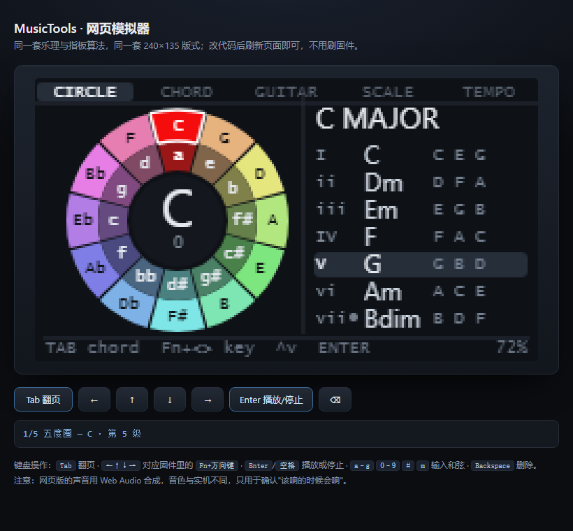
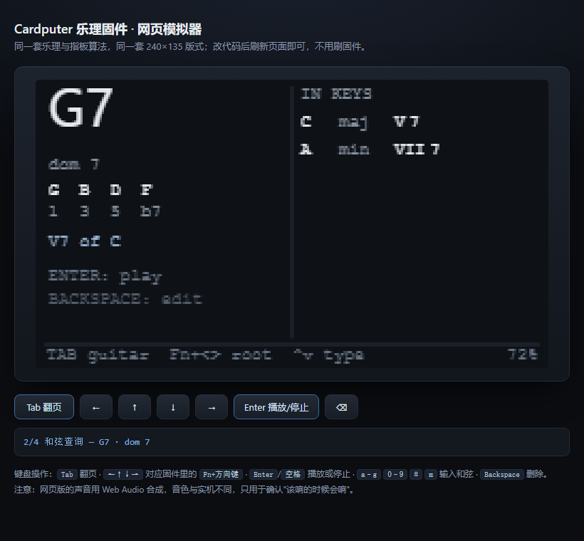
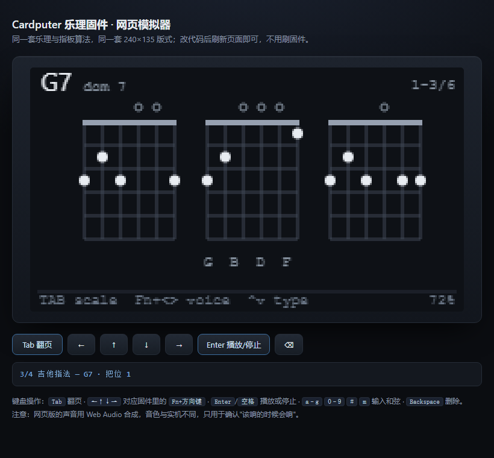
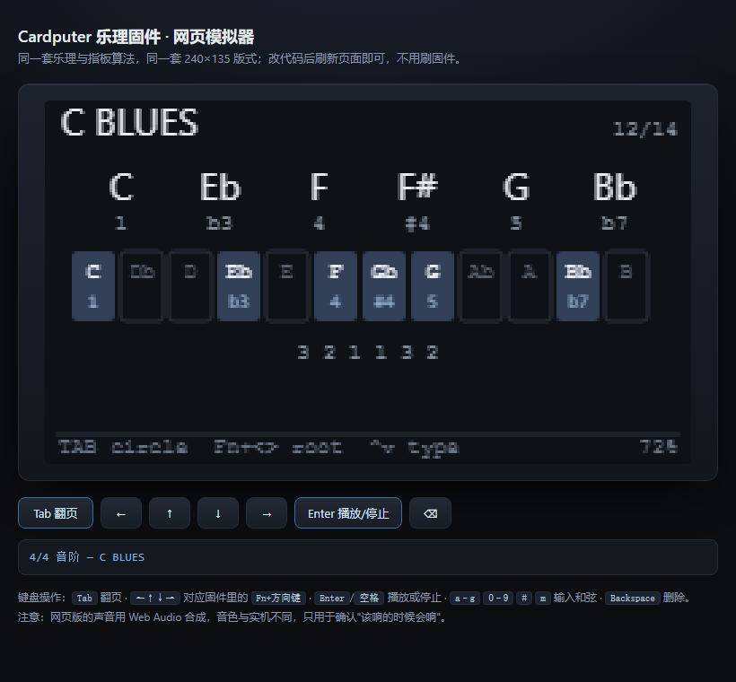
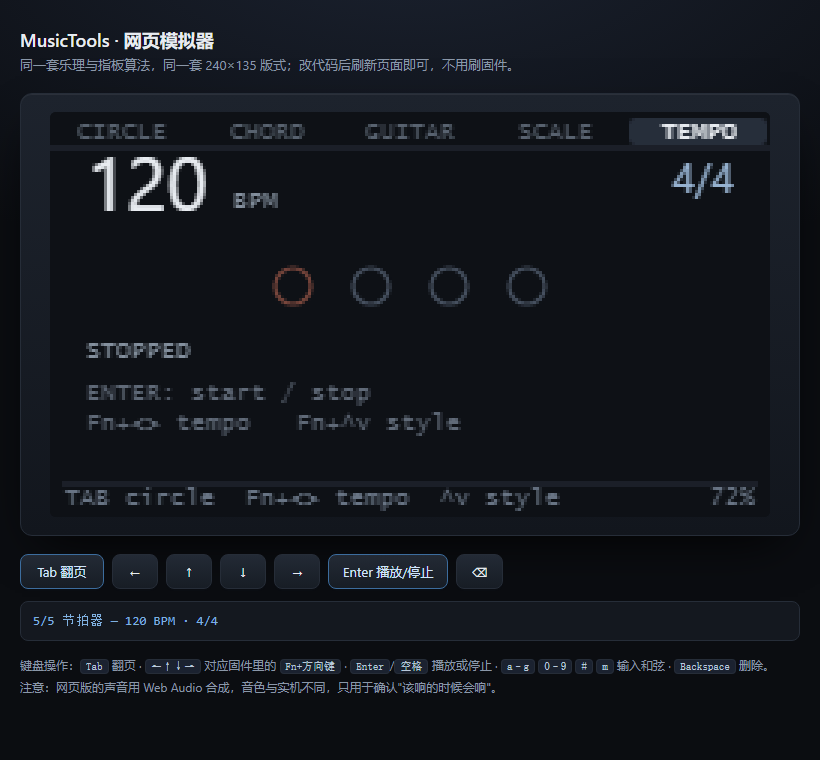

<p align="center">

</p>

# MusicTools

给 M5Stack **Cardputer / Cardputer-Adv** 的乐理工具箱固件。五个页面，Tab 切换：

| 页面 | 内容 |
|---|---|
| **五度圈** | 12 段圆环（外环大调 / 内环关系小调）+ 当前调的 7 个级数和弦 |
| **和弦查询** | 正查：和弦拼写、音程、属性；反查：这个和弦出现在哪些调、是什么级数 |
| **吉他指法** | 该和弦的 3 个把位指法图，方向键翻页看更多 |
| **音阶查询** | 19 种音阶的拼写、级数、12 音位图、音程公式，Enter 试听 |
| **节拍器** | 40–240 BPM，6 种拍号，强拍重音 |

离线、开机即用、按 Enter 直接试听。开机先是 MusicTools 的标志（五度圈圆环），一眼能认出是这个固件。

<p>





</p>

---|---|
| **五度圈** | 12 段圆环（外环大调 / 内环关系小调）+ 当前调的 7 个级数和弦 |
| **和弦查询** | 正查：和弦拼写、音程、属性；反查：这个和弦出现在哪些调、是什么级数 |
| **吉他指法** | 该和弦的 3 个把位指法图，方向键翻页看更多 |
| **音阶查询** | 19 种音阶的拼写、级数、12 音位图、音程公式，Enter 试听 |
| **节拍器** | 40–240 BPM，6 种拍号，强拍重音 |

离线、开机即用、按 Enter 直接试听。

<p>


</p>

---

## 一、刷机

固件文件：**[MusicTools-8MB.bin](https://github.com/saxon267/MusicTools/releases/latest)** （**从 0x0 地址烧写**，已合并 bootloader + 分区表 + 应用；仓库里也有一份 dist/MusicTools-8MB.bin）

### 方式 A：浏览器烧写（推荐，不用装任何环境）

1. 用 Chrome / Edge 打开 <https://espressif.github.io/esptool-js/>
2. 点 **Connect**，选择 Cardputer 的串口（COMx）
3. 选择文件 `MusicTools-8MB.bin`
4. **Flash Address 填 `0x0`**
5. 点 **Program**，等待进度条到 100%

### 方式 B：esptool 命令行

```bash
pip install esptool
esptool.py --chip esp32s3 -p COM3 -b 460800 write_flash 0x0 MusicTools-8MB.bin
```

### 方式 C：M5Burner

M5Burner → 选择设备 → **Custom** / 本地固件 → 选 bin → 烧录地址 `0x0`。

进不去下载模式时：按住侧面 **G0** 再插 USB-C，或按复位后立即按住 G0；烧写完按复位。

---

## 二、操作

顶部 12px 是页面标签栏，当前页高亮，其余变暗，随时知道自己在哪一页、左右还有什么。
底部是操作提示和电量。

### 五度圈页

| 按键 | 功能 |
|---|---|
| `Tab` | 切到和弦查询页（自动带入当前选中的和弦） |
| `Fn` + `,` / `Fn` + `.` | 上一个 / 下一个调 |
| `Fn` + `;` / `Fn` + `/` | 上一 / 下一个级数和弦 |
| `1` … `7` | 直接跳到第 n 级 |
| `m` | 大调 / 关系小调切换 |
| `Enter` / `空格` | 试听选中的和弦 |
| 侧面按钮（G0） | 下一个调 + 试听（键盘失效时的备用操作） |

### 和弦查询页

| 按键 | 功能 |
|---|---|
| `Tab` | 回到五度圈页 |
| `a` … `g` | 换根音（如 `g`） |
| `0`–`9`、`m`、`#` | 接着输入（`g` `7` → G7；`g` `m` `7` `b` `5` → Gm7b5） |
| `Shift` + 字母 | 无论当前内容如何，直接以该字母开头新和弦 |
| `Backspace` | 删除最后一个字符 |
| `Fn` + `,` / `Fn` + `.` | 根音降 / 升半音 |
| `Fn` + `;` / `Fn` + `/` | 切换和弦类型（大三、小三、减、增、7、maj7、m7、m7b5、dim7、6、m6、sus4、sus2、7sus4） |
| `Enter` / `空格` | 试听当前和弦 |

### 吉他指法页

| 按键 | 功能 |
|---|---|
| `Tab` | 切到音阶查询页 |
| `Fn` + `,` / `Fn` + `.` | 上一组 / 下一组把位（每页 3 个） |
| `Fn` + `;` / `Fn` + `/` | 切换和弦类型 |
| `a` … `g` | 换根音，把位自动重算 |

### 音阶查询页

| 按键 | 功能 |
|---|---|
| `Tab` | 回到五度圈页 |
| `Fn` + `,` / `Fn` + `.` | 根音降 / 升半音 |
| `Fn` + `;` / `Fn` + `/` | 切换音阶类型（19 种） |
| `Enter` / `空格` | 上行试听整条音阶（再按停止） |
| `a` … `g` | 直接选根音字母（自然音） |
| `#` | 升半音记号（降半音用 `Fn` + `,` 转调） |

### 节拍器页

| 按键 | 功能 |
|---|---|
| `Tab` | 回到五度圈页 |
| `Fn` + `,` / `Fn` + `.` | 换拍号（4/4 3/4 2/4 6/8 5/4 7/8） |
| `Fn` + `;` / `Fn` + `/` | BPM ±1，按住连发 |
| `Enter` / `空格` | 开始 / 停止 |

### 声音

`Enter` / `空格` 是**开关**：第一次按下试听，播放中再按一次立即停止。不需要等它自己放完。

`-` 和 `=` 调**全局音量**（任何页面都生效，每次 10%），屏幕底部会弹出一条音量条，1.2 秒后自动消失。音量存在 NVS 里，关机重启后保持。

音量默认 100%，`-` / `=` 每次调 10%。合成时还按声部数做了归一化——之前的固定增益让和弦峰值只到半个满量程，这是"声音太小"的主因；现在无论 3 个音还是 4 个音的和弦，峰值都在 0.9 FS 左右，不会因为音多而变小或削波。

> 1 W 的小喇叭物理上限就在那里；如果还想更响，只能靠接 3.5 mm 耳机（Adv 有耳机孔）或外接音箱。

---

## 三、界面读法

顶部 12px 是页面标签栏，当前页高亮，其余变暗，随时知道自己在哪一页、左右还有什么。
底部是操作提示和电量。

### 五度圈页

```
外环：C  G  D  A  E  B  F# | Db Ab Eb Bb F      ← 12 个大调（顺时针为升号方向）
内环：a  e  b  f# c# g# d# | bb f  c  g  d       ← 对应关系小调（小写=小调）
中心：当前调名 + 调号（0 / 3# / 4b）
右栏：I C C E G / ii Dm D F A / ... / vii° Bdim B D F
```

### 和弦查询页

```
G7              ← 当前查询的和弦（Tab 进入时带入五度圈选中项）
dom 7           ← 和弦属性
G  B  D  F      ← 拼写：按字母级数推导，所以 Db7 是 Db F Ab Cb，不是 C
1  3  5  b7     ← 音程
V7 of C         ← 属七的解决目标（仅属七类显示）

                │ IN KEYS
                │ C   maj   V7      ← 这个和弦在哪些调里、是第几级
                │ A   min   VII7
```

反查对 **12 个大调 + 12 个自然小调**逐一比对：把每个调第 1–7 级的三和弦/七和弦都算出来，音程集合完全一致才算命中。所以 Cmaj7 会同时出现在 C 大调 I、G 大调 IV、A 小调 III、E 小调 VI；而 G7 只出现在 C 大调 V7 和 A 小调 VII7。

> 注：`6` / `m6` / `sus` 这类和弦不是任何自然调的级数和弦，反查会显示 `not diatonic in any key`。这是正确的，不是 bug。

### 吉他指法页

```
G7            dom 7                          1-3/6
  o   o   o
 ┌─┬─┬─┬─┬─┐          ← 每格 10×13 像素，5 个品位
 │ │ │ │ │●│
 ...
 G  B  D  F                                   ← 构成音
```

- 顶部 `o` = 空弦，`×` = 不弹
- 实心圆点 = 按弦位置；横跨多弦的圆角条 = 大横按
- 左侧 `5fr` 表示这一段从第 5 品开始（开放把位不显示）
- 每页 3 个把位，右上角显示当前范围

### 音阶查询页

```
D DORIAN                              2/14
D    E    F    G    A    B    C
1    2   b3    4    5    6   b7
[C][C#][D][D#][E][F][F#][G][G#][A][A#][B]   ← 12 音位图，在音阶内的亮起
 b7      1      2  b3      4      5    6    ← 每个音级数
2 1 2 2 1 2 2                              ← 相邻音的半音数
```

支持的 19 种音阶：大调、Dorian、Phrygian、Lydian、Mixolydian、Aeolian、Locrian、和声小调、旋律小调、Lydian dominant、Phrygian dominant、匈牙利小调、大调五声、小调五声、布鲁斯、Bebop dominant、全音阶、减音阶、半全减音阶。

拼写同样按字母级数推导：`B Lydian` 会显示 `B C# D# E# F# G# A#`，`C Blues` 是 `C Eb F F# G Bb`（`#4` 和 `4` 共用字母），不会出现 `Gb` 这种错拼。

指法不是查表，而是按和弦音程在指板上搜索：要求包含根音、三音（七和弦还要求七音），五音可省略，低音必须是根音，品位跨度 ≤ 4，至少 4 根弦发声，再按“把位低、跨度小、弦多、少闷音”排序。12 个大小三和弦额外内置了标准开放/横按指型作为首选，所以 C 一定先给 `x32010` 而不是某个算法生成的怪形状。

---

## 四、网页模拟器（不用刷固件）

`sim/index.html` 双击就能开，不需要装任何东西、不需要起服务器。


同一个 240×135 画布、同样的四个页面、同样的按键行为，连按 Enter 的"播放/停止"开关都一致。改完 UI 或逻辑刷新页面即可看到结果，确认没问题再刷固件。

| 模拟器按键 | 固件按键 |
|---|---|
| `Tab` | `Tab` |
| `←` `→` `↑` `↓` | `Fn` + `,` `.` `;` `/` |
| `Enter` / 空格 | `Enter` / 空格 |
| `a`–`g` `0`–`9` `#` `m` | 同上 |
| `-` / `=` | `-` / `=`（音量） |
| `Backspace` | `Backspace` |

页面下方也有一排按钮，平板上可以直接点。


**深链接**（方便核对某一屏）：`index.html#page=2&chord=G7&key=7&scale=11`

- `page` 0–4：五度圈 / 和弦 / 吉他 / 音阶 / 节拍器
- `chord`：任意和弦名，如 `G7`、`F#m7b5`
- `key`：五度圈的第几格（0 = C）
- `scale`：音阶序号（0 = 大调，11 = 布鲁斯）

> 说明：模拟器是把 `theory.cpp` / `guitar.cpp` / `ui.cpp` 的逻辑**移植**成 JS，不是直接跑固件二进制。乐理和指法算法已经用同一批测试数据核对过（12 个调的拼写、24 个调的反查、18 个标准指型），版式常量与 `ui.cpp` 一一对应；但**改逻辑时要两边一起改**，否则会不一致。

---

## 五、从源码构建

```bash
cd firmware
pio run                # 编译
pio run -t upload      # 直接烧写
```

构建产物：`.pio/build/cardputer/firmware.bin`（应用镜像，从 0x10000 烧写）。
`dist/` 里的合并镜像由 `pwsh tools/make_bin.ps1` 生成。
图标由 `python tools/make_icon.py` 生成（`docs/icon*.png`）。

依赖：PlatformIO + `espressif32@6.9.0`；库 `M5Unified 0.3.0`、`M5GFX 0.3.0`、`M5Cardputer 1.1.1`（自动安装）。

---

## 六、代码结构

| 文件 | 职责 |
|---|---|
| `src/theory.h/.cpp` | 纯 C++ 乐理层，无硬件依赖：音名拼写、音阶、级数和弦、调号、和弦字典、正查/反查 |
| `src/guitar.h/.cpp` | 指板搜索：音程约束 + 把位打分，输出可弹的指法 |
| `src/theory.h/.cpp`（音阶表） | 14 种音阶的半音偏移 + 字母级数，用于正确拼写 |
| `src/ui.h/.cpp` | 240×135 两个页面，全部绘制到 sprite 后一次性推送 |
| `src/audio.h/.cpp` | 和弦合成（正弦叠加 + ADSR），16 kHz 单声道，最多 5 个声部 |
| `src/main.cpp` | 按键边沿检测、页面状态机、和弦输入解析 |
| `sim/` | 网页模拟器：`theory.js` / `guitar.js` / `ui.js` / `app.js`，逻辑从 C++ 移植 |

关键实现点：

- **音名拼写不是查表**：内部用「字母 0–6 + 升降号 −2..+2」建模，音阶和和弦都按字母级数推导，所以 `B#`、`Cb`、`F##` 这类拼写是自然算出来的。
- **反查用音程集合精确匹配**，不是按和弦名匹配字符串，因此同音异名（C6 与 Am7）不会被误判。
- 资源占用：RAM 16.0%（约 52 KB 静态 + 93 KB 堆），Flash 18.1%（569 KB / 3 MB）。

---

## 七、已知限制（重要）

1. **部分功能只做过离线和模拟器验证**：早期版本已在 Cardputer-Adv 真机上确认过显示、键盘、和弦发声都正常；之后新增的吉他指法、音阶播放、节拍器还没有逐项上机确认，遇到问题请开 issue 描述现象。
2. **依赖 M5GFX 的板卡自动识别**：固件用 `M5.getBoard()` 区分一代（GPIO 矩阵键盘）和 Adv（TCA8418 键盘）。识别失败时键盘不会响应，此时侧面按钮仍可切换调。
3. **音频**：Adv 走 ES8311（M5Unified 内部回调），一代走 NS4148。若无声，先看串口日志确认 `spk=1`。
4. **和弦输入不能直接打 `dim` / `aug`**：`d`、`a` 会被当作新根音，用 `Fn+;` / `Fn+/` 切换类型即可。
5. **吉他指法是搜索出来的，不是曲谱库**：常见和弦靠内置标准指型保证，冷门和弦（如 `7sus4`、`dim7`）的形状可能不如教材上的顺手，翻几个把位挑一个即可。
6. **音阶试听是单声部上行**：只向上跑一遍，不带节拍和下行；时长 0.22 s/音。
7. **串口日志**：115200 波特率，开机会打印 `[fifths] board=.. panel=..x.. sprite=1 spk=1`，排障先看这一行。

---

## 八、许可证

MIT，见 [LICENSE](LICENSE)。

界面字体使用 M5GFX 内置的 `Font0` / `Font2` / `Font4` / `FreeSans9pt7b`（Adafruit GFX 字体集，源自 GNU FreeFont，GPLv3 + font exception），随库分发。


